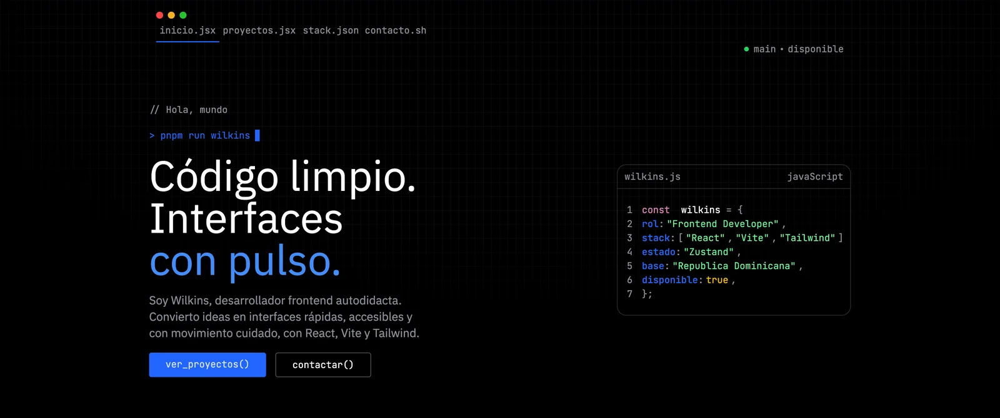
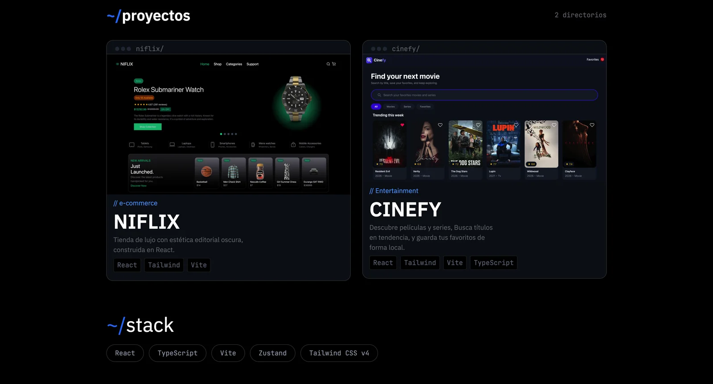
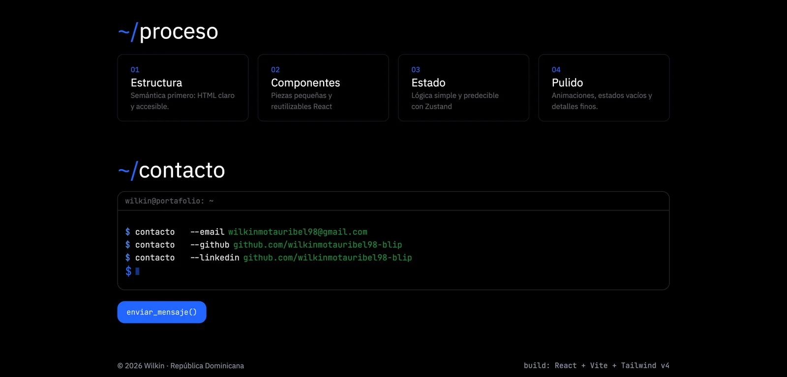

# Portfolio — Wilkin Mota Fraide

Personal portfolio for **Wilkin Mota Fraide**, a self-taught frontend developer. The site is built around a code-editor/terminal aesthetic: dark UI, monospace accents, and a hero that types itself out with GSAP.


**Live site:** https://wilkinmotauribel98-blip.github.io/portfolio/

## Preview

### Hero

A terminal-style intro where the command and headline are typed character by character with GSAP, followed by a staggered reveal of the description, buttons, and code card.



### Projects & Stack

Project cards presented as editor windows, each with a live preview, category, description, and tech badges. The stack section lists the tools used day to day.



### Process & Contact

A four-step process grid (structure, components, state, polish) and a contact block that behaves like a shell session.



## Features

- **GSAP typing animation** — the hero command and headline are typed character by character, with variable speed, punctuation pauses, a custom caret, and a `prefers-reduced-motion` fallback.
- **No flash of unstyled content** — animated elements are hidden only when JavaScript is available, then revealed by the timeline.
- **Terminal/editor design system** — dark palette, blue accents, `JetBrains Mono` for code-like UI, `IBM Plex Sans` for reading text.
- **Responsive layout** — fluid sections built with Tailwind CSS v4 and CSS grid/flexbox.
- **Accessible** — semantic sections, `aria-label` on the typed headline, reduced-motion support.
- **Static output** — fully prerendered with Astro; no client framework required.

## Tech Stack

| Area | Technology |
| :--- | :--- |
| Framework | [Astro](https://astro.build) 7 |
| Styling | [Tailwind CSS](https://tailwindcss.com) v4 |
| Animation | [GSAP](https://gsap.com) 3 |
| Language | TypeScript (strict) |
| Linting | ESLint + `eslint-plugin-astro` + `typescript-eslint` |
| Package manager | pnpm |
| Fonts | IBM Plex Sans, JetBrains Mono (self-hosted via Fontsource) |

## Project Structure

```text
portfolio/
├── .github/
│   └── workflows/         # GitHub Pages deployment
├── docs/                  # README screenshots
├── public/                # Static assets (favicon, OG image)
├── src/
│   ├── assets/            # SVGs used by components
│   ├── components/
│   │   ├── contact/       # Contact section
│   │   ├── footer/        # Footer
│   │   ├── header/        # Top navigation
│   │   ├── hero/          # Hero, buttons, and code card
│   │   ├── process/       # Process section and cards
│   │   ├── projects/      # Projects section and cards
│   │   ├── stack/         # Stack section
│   │   └── ui/            # Shared UI primitives (Badge, Dot)
│   ├── layouts/
│   │   └── Layout.astro   # HTML shell, fonts, global background
│   ├── pages/
│   │   └── index.astro    # Single-page composition
│   └── styles/
│       └── global.css     # Tailwind theme, fonts, cursor animation
├── astro.config.mjs
├── eslint.config.js
├── package.json
└── tsconfig.json
```

## Getting Started

### Prerequisites

- **Node.js** `>=22.23.4`
- **pnpm** (recommended; the project ships a `pnpm-lock.yaml`)

### Install and run

```sh
pnpm install
pnpm dev
```

The dev server starts at `http://localhost:4321`.

### Production build

```sh
pnpm build
pnpm preview
```

`pnpm build` writes the static site to `./dist/`.

## Scripts

| Command | Description |
| :--- | :--- |
| `pnpm dev` | Start the local dev server |
| `pnpm build` | Build the production site to `./dist/` |
| `pnpm preview` | Preview the production build locally |
| `pnpm lint` | Run ESLint across the project |
| `pnpm astro ...` | Run Astro CLI commands |

## How the Typing Animation Works

The hero script (`src/components/hero/Hero.astro`) uses GSAP timelines instead of a typing plugin:

1. Each typed element keeps its text in a variable and renders it through an empty text node.
2. `typeInto()` builds a sub-timeline with one step per character, adding random jitter and extra pauses after punctuation.
3. A caret element is moved to the line being typed, stays solid while typing, and blinks during pauses.
4. The main timeline chains the intro, command, headline, description, buttons, and code card.
5. If the user prefers reduced motion, the final state is shown immediately.

## Deployment

Every push to `main` triggers `.github/workflows/deploy.yml`, which installs dependencies with pnpm, builds the site, and publishes `dist/` to GitHub Pages.

The project is served as a project site under `/portfolio/`, so `site` and `base` are set in `astro.config.mjs`.

In the repository, make sure **Settings → Pages → Build and deployment → Source** is set to **GitHub Actions** before the first deployment.

## Contact

- **Email:** [wilkinmotauribel98@gmail.com](mailto:wilkinmotauribel98@gmail.com)
- **GitHub:** [@wilkinmotauribel98-blip](https://github.com/wilkinmotauribel98-blip)
- **Repository:** [wilkinmotauribel98-blip/portfolio](https://github.com/wilkinmotauribel98-blip/portfolio)

---

Personal project by Wilkin Mota Fraide. Content is written in Spanish; the UI language can be changed in the components under `src/components/`.
